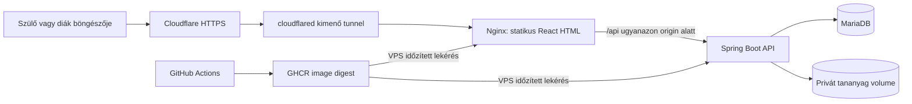
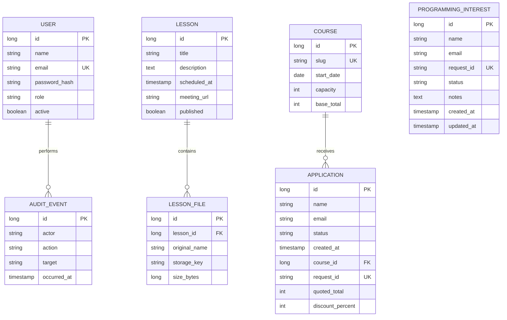

# Rendszerarchitektúra

Állapot: 2026-10-21, helyi alkalmazás és éles telepítés előkészítése. Az aktuális üzleti döntések a [stratégiában](STRATEGY-2026-10.md), az API a [backend szerződésében](../../backend/API.md), a konkrét ellenőrzési eredmények a [HANDOFF](HANDOFF.md) fájlban találhatók. Ez a leírás nem állítja az éles telepítés vagy minden teszt sikerét.

## Cél és határok

A `diku-erettsegi.hu` személyes, tantermi, emelt szintű digitális kultúra érettségi előkészítőt mutat be. Két szombati csoporthoz fogad jelentkezést, és külön rögzíti a programozós érdeklődőket. A védett felület tananyagokat és órainformációkat ad a diákoknak; az adminok kezelik a jelentkezéseket, érdeklődőket, felhasználókat és órákat. A szervezők kézzel veszik fel a kapcsolatot: az alkalmazás nem küld e-mailt.

Az első változat nem tartalmaz online fizetést, vizsgáztatást, videókonferenciát, teljes LMS-t vagy drag-and-drop CMS-t. Az értekezlethez külső HTTPS-link kapcsolódik. Ezek új igényként külön tervezhetők.

## Három repository

| Mappa | Felelősség | Fő eredmény |
| --- | --- | --- |
| `../frontend` | React + TypeScript + Vite, nyilvános és szerepkörös felületek, előállított HTML, Nginx | Frontend Docker image |
| `../backend` | Java 21 + Spring Boot 3.5, REST API, Spring Security, üzleti logika, fájltárolás, Flyway | Backend Docker image |
| `.` (`database`) | MariaDB 11.4 LTS, helyi és későbbi éles Compose, mentés/deploy-előkészítés, közös dokumentáció | Futtatási konfiguráció és runbook |

A Java 21 illeszkedik a választott Spring Boot 3.5 verziócsalád támogatott Java-tartományába. Az alkalmazás pontos függőségeit a backend `pom.xml` rögzíti. [Spring Boot rendszerkövetelmények](https://docs.spring.io/spring-boot/3.5/system-requirements.html). A MariaDB 11.4 hosszú támogatású sorozat; az éles image pontos digestjét telepítés előtt kell kiválasztani. [MariaDB 11.4 LTS](https://mariadb.org/11-4-lts/).

## Forgalom

Lokálisan a böngésző a frontend dev szervert vagy a Compose frontendjét éri el; a proxy továbbítja az `/api` kéréseket. A Cloudflare csak a későbbi éles útvonal része. Élesben a Compose nem publikál adatbázis-, backend- vagy webportot a hoston; a tunnel a belső `frontend:80` szolgáltatást éri el.

## Frontend és SEO

A build 18 ismert útvonalhoz és külön 404-hez állít elő HTML-t. A publikus szöveg és metaadat már ebben szerepel; a kurzusválasztó az aktuális árat és szabad helyet az API-ból frissíti. Az alapinformáció olvasható JavaScript nélkül is. A React a böngészőben kezeli az űrlapokat és a belső felületeket. Statikus fájlokat Nginx szolgál ki; nincs külön Node renderelő folyamat a VPS-en.

Minden indexelhető oldalhoz egyedi URL, title, H1, leírás és canonical tartozik. Admin, belépés, tanulói felület, jogi piszkozat, programozási ízelítő és hibaoldal `noindex`. A sitemap az indexelhető route-okat tartalmazza. A megjelenés helyben tárolt, optimalizált stockfotókat használ; eredetük a [képjegyzékben](IMAGE-ASSETS.md) követhető. Részletes szabályok: [SEO](SEO.md).

A publikus szövegek egyelőre verziókezelt frontend tartalmak. Az admin tanulói tartalmat kezel; a marketingoldal szerkesztésére szolgáló CMS egy későbbi, külön döntés.

## Backend és adatmodell

Moduláris monolit: hitelesítés, csoportok és árazás, jelentkezések, kézzel feldolgozott programozós érdeklődések, felhasználók, órák és fájlok, audit. Egy példányos működésre tervezzük; horizontális skálázás nincs megvalósítva.

Az alábbi ábra logikai modell. A fizikai táblák, mezőnevek és korlátozások hiteles forrása a backend `src/main/resources/db/migration` könyvtára.

A jelentkezés nem azonos egy tanulói fiókkal. Két jelentkezési csoport van, csoportonként legfeljebb 24 elfogadott jelentkezéssel. A `NEW`/`CONTACTED` nem foglal helyet; az `ACCEPTED` igen. Elfogadáskor a tranzakció zárolja a csoportsort, majd újra számolja a helyeket; túllépés 409. A csoportokhoz egyelőre nem tartozik tananyag-tagság: minden aktív diák minden publikált órát lát. A diákfiókot az admin hozza létre.

Az árhoz a backend Budapest szerinti dátuma választ 25%/15%/0% időszakos kedvezményt. A baráti rész `5 × max(friendCount, referredByFriend ? 1 : 0)`; az összes kedvezmény legfeljebb 35%. A szerver a létrehozási időponttal együtt menti az alapárat, a kedvezménybontást és a teljes/tanóradíjat. Státuszmódosítás vagy későbbi határidő nem írja át ezt. A baráti jogosultságot az admin külön egyezteti; az ár nem fizetési visszaigazolás.

A két nyilvános beküldési folyamat UUID `requestId`-t használ. Azonos UUID és normalizált tartalom az eredeti rekordot adja; eltérő tartalom 409. Egyedi adatbázis-korlátozás és tranzakciós kezelés akadályozza a párhuzamos duplikálást. A kliens hálózati ismétléskor megtartja az azonosítót, szerkesztett tartalomhoz újat generál.

A programozós érdeklődés `NEW → CONTACTED → COMPLETED` állapottal és belső megjegyzéssel kezelhető. Az admin módosítás új `updatedAt` időt kap, a `createdAt` változatlan. Nincs SMTP-függőség, automatikus levél, háttérküldő vagy újraküldési végpont. A szervezők a saját levelezőjükből küldhetnek linket.

Migrációk: V1 az alapmodell; V2 a csoportok, ár-pillanatképek és érdeklődések; V3 a kedvezménybontás, meghívottság és kézi érdeklődőkezelés. A V2 történeti `mail_outbox` táblája megmarad, de a futó alkalmazás nem használja. Meglévő migráció checksumját nem írjuk át, a korábbi jelentkezések és áraik megmaradnak.

Az audit és létrehozási időpontok UTC Instant értékek. Az órák startsAt mezője kifejezetten Europe/Budapest szerinti LocalDateTime (falióra); a frontend nem értelmezi át a néző eszközének zónájába. Több időzónás eseménykezelés esetén külön, offsetet/zónát megőrző migráció kell.

## Biztonság és fájlok

Same-origin, szerveroldali session és CSRF védelem. A session cookie HttpOnly; production környezetben Secure és megfelelő SameSite beállítás szükséges. A frontend route-védelem kényelmi funkció; minden jogosultságot az API kényszerít ki. A jelszó hash formában tárolódik; nem kerül URL-be, logba vagy frontend tárolóba.

A fájl metaadata adatbázisban, tartalma privát Docker volume-on él. A letöltés hitelesített API-n keresztül történik; a nyilvános Nginx könyvtár nem kapja meg a feltöltéseket. A fájl eredeti neve megjelenítési adat, a tárolási név szerver által generált kulcs. Menteni kell a DB-t és a fájlokat is. A tényleges védelmek és élesítés előtti teendők a [SECURITY](SECURITY.md) fájlban.

## Állapot és élettartam

- A DB és upload volume túléli a konténer újralétrehozását. A `down -v` törölheti az adatokat; nem része a normál frissítésnek.
- A Flyway verziózott migrációkat a backend induláskor alkalmazza. A Hibernate sémaellenőriz, nem alakíthatja át önállóan az éles sémát. [Flyway verziózott migrációk](https://documentation.red-gate.com/flyway/flyway-concepts/migrations/versioned-migrations).
- Az első változat egy backend példányához tartozó session újraindításkor megszűnhet; a felhasználó újra belép. Tartós vagy többpéldányos session külön fejlesztés.
- API-kompatibilitás és hozzáadó migrációk szükségesek, mert a három repository külön verziózódik. Törlő sémaváltás csak külön ütemezett átállással.
- Az audit üzleti eseményt rögzít; a konténerlog hibakeresésre szolgál. Egyik sem teljes körű biztonsági monitorozás.

## Üzemeltetési irány

GitHub Actions teszteli és buildeli a frontend/backend image-et, majd GHCR-be publikálja. A VPS időzítője a publikált `main` image-ek digestjét vizsgálja; változáskor mentés, pull, frissítés és health ellenőrzés következik. Sikertelen alkalmazásindításnál az előző image-ekre lehet visszaállni. Egy adatbázis-migrációt ez nem von vissza. A folyamat terve és az aktiválás határai: [DEPLOYMENT](DEPLOYMENT.md).
