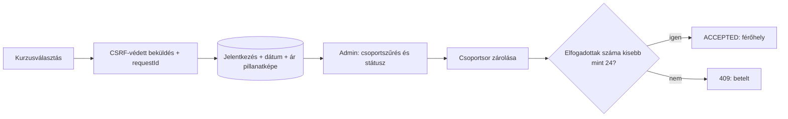

# Stratégia és megvalósítás – frissítve: 2026. október 21.

Az október 20-i stratégia és az október 21-i pontosítás a mérvadó: **a kedvezmények összeadódnak, maximum 35%-ig; a levelezés manuális; csak stockfotók használhatók.** A megvalósítás helyi alkalmazásfejlesztés, élesítés nélkül. Az ellenőrzési eredmények a HANDOFF.md-ben találhatók.

## Célok

1. Emberközeli főoldal, személyes tantermi felkészülés és jól látható kurzusválasztás.
2. Két csoporthoz tartozó jelentkezések, megőrzött dátummal és szerver által számított díjjal.
3. Tartós programozós érdeklődői nyilvántartás, admin által kézzel kezelt státusszal és megjegyzéssel.
4. Szülői/diákoldalak, konkrét árak és oktatók, helyszín, hivatalos érettségi letöltések, előrenderelt SEO.
5. Meglévő adatok megőrzése, verziózott migrációk és következő agenteknek dokumentált működés.

## Képzési adatok

- 2027. január 9., szombati kezdés. Az év a 2026. októberi aktuális időpontból és a megadott szombatból következik.
- 20 alkalom × 4 tanóra × 45 perc = **80 tanóra**, azaz 60 darab 60 perces óra.
- Szombat 09:00–13:00 vagy 14:00–18:00; a négyórás idősáv szüneteket is tartalmaz.
- Maximum 24 elfogadott jelentkezés csoportonként, két oktató: Balázs és Peti.
- Budapest XI. kerület, Gábor Dénes Egyetem, Bikás park közelében; a terem és részletes megközelítés még kitöltendő.
- Saját laptop vagy bérlési igény; a bérlés díja és feltételei később pontosítandók.
- 3 500 Ft/tanóra × 80 = 280 000 Ft alapdíj; tanulói portál, próbaérettségik és javításuk, próbaszóbelik.

**Naptári egyeztetés szükséges:** húsz egymást követő szombat január 9-től május 22-ig tart. Az ünnepi szünetek és a célzott érettségi időpontjához igazítás még véglegesítendők. Nem generálunk automatikusan húsz publikált órát vagy garantált befejezési dátumot.

## Jelentkezés és férőhely

Új jelentkezésnél kötelező a csoport. A régi rekordok csoport nélkül megmaradnak. NEW és CONTACTED nem foglal helyet, ACCEPTED igen; az abból való kilépés felszabadítja. Betelt/lezárt csoportba nincs új nyilvános beküldés. Elfogadáskor zárolás mellett újra ellenőrzünk, hogy párhuzamos adminműveletek se lépjék túl a létszámot.

A jelentkezés szándéknyilatkozat, nem online fizetés és nem automatikus tanulói fiók. A tananyagok továbbra is közösek minden aktív diáknak: a jelentkezési csoport még nem tananyag-hozzáférési tagság.

A kliens UUID requestId-t küld. Azonos azonosító és normalizált tartalom újrapróbálása ugyanazt a rekordot és mentett árat adja; eltérő tartalom ugyanazzal azonosítóval 409. A DB egyedi korlátozása és a tranzakciós kezelés védi a párhuzamos kéréseket.

## Díjak és kedvezmények

| Időszak, Europe/Budapest helyi dátum szerint | Időszakos kedvezmény | Teljes díj barát nélkül | 45 perces tanóra |
| --- | --- | --- | --- |
| 2026. november 15. nap végéig | 25% | 210 000 Ft | 2 625 Ft |
| November 16. – december 15. nap végéig | 15% | 238 000 Ft | 2 975 Ft |
| December 16-tól | 0% | 280 000 Ft | 3 500 Ft |

Barátonként 5% jár a hozónak, a meghívott barátnak pedig 5%. A formban külön szerepel a hozott barátok száma és a „Barát ajánlásával érkezem” jelölő. Ugyanazt a kapcsolatot nem számoljuk kétszer: a képletben a barátszám `max(hozottBarátok, ajánlássalÉrkezik ? 1 : 0)`.

`összesKedvezmény = min(35, időszakosSzázalék + 5 × figyelembeVettBarátok)`

| Példa | Összes kedvezmény | Teljes díj | Tanóradíj |
| --- | --- | --- | --- |
| Super Early Bird + 1 barát | 30% | 196 000 Ft | 2 450 Ft |
| Super Early Bird + 2 barát | 35% | 182 000 Ft | 2 275 Ft |
| Early Bird + 1 barát | 20% | 224 000 Ft | 2 800 Ft |
| Alapár + 1 barát | 5% | 266 000 Ft | 3 325 Ft |
| Alapár + 2 barát | 10% | 252 000 Ft | 3 150 Ft |

A backend órája és számítása mérvadó. Mentjük a szerver UTC createdAt időpontját, az alapárat, az időszakos és baráti százalékot, a plafonnal korlátozott összes százalékot, a teljes díjat és a tanóradíjat. Státuszváltás vagy határidő átlépése nem módosítja ezeket.

A baráti jogosultság önbevalláson alapul, az admin egyezteti a megjegyzés alapján. Az összesített ár már számol a bejelentett barátokkal, de nem jelent ellenőrzött pénzügyi elszámolást. Nincs automatikus barát-összepárosítás, kupon vagy fizetés. A nyers baráti százalék lehet nagyobb a plafonnál; a tényleges összes százalék soha nem haladja meg a 35%-ot.

## Programozós érdeklődők – kézi feldolgozás

A nyilvános form nevet, e-mailt és a tájékoztató megismerésének jelölését kéri. A CSRF-védett POST idempotensen adatbázisrekordot hoz létre. Az admin külön menüpontban látja és szerkeszti:
- NEW: új érdeklődő;
- CONTACTED: kapcsolatfelvétel megtörtént;
- COMPLETED: feldolgozva;
- belső megjegyzés és a módosítás időpontja.

**Az alkalmazás nem küld e-mailt.** Nincs SMTP-függőség, háttérküldő, küldési sor feldolgozása, e-mail-újrapróbálás vagy Mailpit szolgáltatás. A szervezők a saját levelezőjükből küldik a linket, majd frissítik az admin státuszt. A form sikerüzenete kizárólag a mentést igazolja.

A V2 migrációban történetileg létrehozott mail_outbox tábla megmarad, de nincs használatban; egy már létező migráció checksumját nem írjuk át. V3 adja az új kézi feldolgozási mezőket és a kedvezménybontást. A történeti tábla későbbi külön migrációval takarítható, ha nincs benne megőrzendő adat.

A /programozas-izelito opcionális noindex oktatópélda megmarad, kézi hivatkozásként használható. Nem futtat látogató által bevitt kódot.

## Tartalom és források

- /kurzusok: csoportok és jelentkezés; /jelentkezes régi útvonal működik.
- /szuloknek, /diakoknak: saját H1/title/canonical, rövid kérdés–válaszok.
- /erettsegi-feladatsorok: öt időszak, húsz OH-fájl; PDF feladatlap/javítás, ZIP forrás/megoldás.
- Elérhetőség: info@diku-erettsegi.hu; +36 1 000 0000 jelölt, nem kattintható telefonhelyőrző.
- [Stockfotók és licenc](IMAGE-ASSETS.md): helyi, optimalizált WebP, valódi Pexels-fotók.
- Nincs garantált pontszám, bizonyítatlan oktatási hatásosság vagy piaci árösszehasonlítás. A felvételi beszámítás a választott szak követelményeitől függ.

Az [Oktatási Hivatal archívumából](https://www.oktatas.hu/kozneveles/erettsegi/feladatsorok) kiválasztott 2024 tavaszi/őszi, 2025 tavaszi/őszi és 2026 tavaszi fájlokat 2026-10-20-án ellenőriztük. Mind a húsz HTTP GET 200 és valódi PDF/ZIP volt. Az OH HEAD-kéréseket idő előtt lezárta. Konkrét eredeti hivatkozások: frontend/src/examSources.ts; nincs saját tárhelyre másolás.

## Véglegesítésre vár

A 20 alkalom részletes naptára; fizetési/lemondási feltételek; barátok kézi ellenőrzésének folyamata; laptopbérlés; portrék; terem; telefonszám; jogi szövegek és megőrzési/törlési idők; végleges kóstolóanyag. SMTP-beállítás nem feladat.
